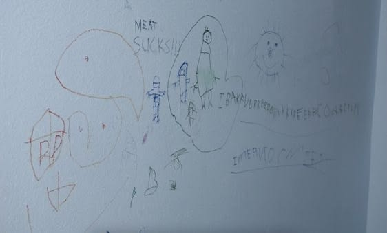

<div align="center">


<br />


</div>

## `// current process`

```text
building things that probably shouldn't know my name
```

## `// traces left behind`

<div align="center">


<br />


</div>

<details>
<summary><code>artifact_001.jpg</code> — recovered from the margins</summary>
<br />



</details>

<div align="center">

<sub>IF THE SCREEN GOES DARK, WAIT FOR THE CURSOR.</sub>

</div>
